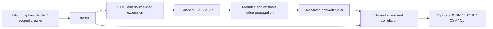

# Architecture and coverage

SAD is a bounded static analyzer, not a JavaScript runtime. Its success measure is evidence-backed coverage of potentially invokable operations. Results are candidates, not proof of reachability, successful authorization, or server existence.

## Module responsibilities

| Module | Responsibility |
| --- | --- |
| `models` | Public input, evidence, endpoint and result dataclasses |
| `ingest` | Capture adapters and bounded input reads |
| `html` | HTMLParser-based scripts, links and forms |
| `javascript/parser` | Tree-sitter grammars and locked content-addressed LRU |
| `javascript/values` | Unknown, function closure, client, bound member and value unions |
| `javascript/engine` | Module graph, environments, calls, bounded interpretation and sink adapters |
| `javascript/resources` | AST import discovery and source-map embedded sources |
| `protocols` | Extensible package/global sink registry |
| `crawler` | Scoped resource acquisition; never invokes discovered APIs |
| `normalization` | Canonicalization, exact/symbolic correlation and deduplication |
| `output`, `cli` | Frontends over the same result objects |

The engine loads available modules on demand, links imports, resolves constants/objects/member accesses, and propagates abstract arguments through calls. Calls record caller/callee edges. Uncalled function bodies are explored with symbolic parameters to discover hidden APIs. This can emit both a broad wrapper candidate and a specialized caller result. Branches are explored independently and simple scalar assignments are joined into bounded alternatives. Aliased known clients remain sinks; an arbitrary object method called `get` does not.

## Current coverage

| Input or pattern | Implemented behavior | Limits |
| --- | --- | --- |
| JS, TS, JSX, TSX, minified code | Tree-sitter parsing and error recovery | Unsupported syntax is traversed for nested sinks; not full semantics |
| Strings and configuration | Constants, concatenation, templates, objects, spread, explicit environment values | No arbitrary built-in execution or computed string algorithms |
| Calls | Function declarations, arrows, aliases, destructuring, nested wrappers, returned closures, basic classes | Basic inheritance, receivers and `bind`/`call`/`apply` are supported; decorators, prototype mutation and a full async scheduling model remain incomplete |
| Branches | Isolated abstract branch heaps, return unions, aliases, bounded loops and recursive summaries | Up to 16 alternatives, 64 loop iterations and eight recursive-summary rounds; widening and recursion emit issues. Exception paths are conservative. |
| Modules | Relative ESM/CommonJS, default/named exports, re-exports, namespace imports, literal dynamic imports | Cyclic binding cells and explicitly supplied path mappings are supported; package exports and automatic tsconfig loading remain incomplete |
| fetch, XHR, beacon | URLs, methods, request objects, headers and bodies | XHR open/send/header mutations are linked; response semantics remain incomplete |
| Axios, jQuery | Calls, HTTP verbs, factory base URLs and headers | Factory/default configuration and request overrides supported; interceptors remain incomplete |
| ky, got, ofetch, unfetch, request, superagent, wretch | Imported client conventions, common factories, verb calls; basic wretch chains | Fluent response/body modifiers and advanced per-library options incomplete |
| Angular | Imported HttpClient parameter annotation recognized | Framework DI/decorators and constructor property promotion incomplete |
| Custom/React/Vue/Svelte/generated clients | Follow their source to known sinks; explicit package registration | Opaque external implementations need adapters; no framework-name guessing |
| GraphQL/Apollo/urql/graphql-request | Configured URLs and common query/request calls; JSON query payload detection | Operation parsing, Apollo link composition, Relay artifacts/subscriptions incomplete |
| WebSocket, Socket.IO, SSE | Connection targets from constructors/imported clients | Event channels, reconnection configuration, Socket.IO transport path not modeled |
| JSON-RPC, SOAP | Structured JSON-RPC bodies and SOAP content-type/header evidence | No WSDL/service discovery |
| gRPC-Web | `GrpcWebClientBase` RPC URL calls and content-type evidence | Protobuf reflection and opaque generated modules incomplete |
| Connect-Web, tRPC | Known transport/client factories and conventional method/procedure paths | Literal Connect descriptors supply wire names; opaque protobuf encodings, batching and advanced link chains remain incomplete |
| Forms | Declarative forms, controls, basic `createElement('form')` action/method/submit | No DOM tree execution, event-driven mutation, form-owner lookup or shadow DOM |
| Bundles/chunks | Parse ordinary JS in bundles, inspect uncalled factories, follow literal imports | Static numeric Webpack/Parcel module tables and literal ESM chunks are supported; arbitrary loader execution and computed manifests remain unsupported |
| Source maps | External maps supplied/collected, base64 inline maps, embedded sources with original names/lines | VLQ original locations and inline indexed sections are supported; external indexed sections must be supplied, and source names never authorize filesystem reads |

## Confidence and evidence

Every endpoint has AST/form/capture evidence and a location when available. Calls through wrappers include their call chain; configured bases include factory evidence. Source-map embedded sources use `map#section-N:source-N:original-name` provenance.

- **High:** a resolved known network sink and concrete URL; observed traffic and HTML declarations also qualify. A high score does not prove runtime reachability.
- **Medium:** symbolic URL segments, or conventional tRPC/Connect paths whose wire representation may differ.
- **Low:** a URL beginning with an unresolved symbolic base.

Unknown metadata uses JSON null, and symbolic strings use `{id}` or `{dynamic}`. Unknown methods are null, never silently asserted as GET. GET is used only for APIs with that default. `origin` is `static-analysis`, `observed`, `observed+static`, or reserved `inferred`; current protocol heuristics use static-analysis with medium confidence.

## Correlation

Canonicalization lowercases scheme/host, removes fragments and default ports, and preserves path case, encoded delimiters and query order. Correlation requires matching protocol, origin and method, preferring exact paths over symbolic paths. Queries are retained in parameters and observations. Multiple different numeric observed paths with a shared structure can be grouped under `{id}`; a single numeric path is kept concrete. This is a heuristic, not a claim of server routing semantics. Original URLs, headers, bodies, status and evidence remain attached.

A logical endpoint's top-level request metadata is a representative, not a complete union of every possible static payload. Evidence retains the contributing calls; raw traffic variants remain in observations and merged static configurations in request_variants. Multiple GraphQL operations sharing a transport URL are not yet modeled as separate operations.

## Budgets, determinism and concurrency

Default AST cache: 128 entries, keyed by grammar and SHA-256 content, with an 8 MB per-resource limit. Default interpreter budgets: 200,000 steps, call depth 20, 16 branch alternatives, 64 loop iterations and eight recursive-summary rounds. Reuse an Analyzer to avoid reparsing unchanged content; value evaluation remains per analysis. The cache lock protects parsing, but parallel parsing is not enabled. For parallel analyses, use separate Analyzer instances per worker rather than modifying a registry concurrently.

The step limit is a global bound, divided into source shares after parsing. Each source's top-level code and function exploration consume its share; imported code consumes the defining source's share. Exhausting a source retains its partial exports and operations and emits an `analysis-budget` issue with that source's location. Independent sources continue. Unused shares are not reassigned, and a budget too small to visit every source still stops at the global bound. The CLI exposes `--max-steps`; `--depth` and `--max-pages` govern collection rather than abstract interpretation. Increasing steps does not change widening, recursion or loop limits.

Crawling defaults to depth 2, 30 pages, 300 resources, 8 MB per response, 64 MB aggregate decoded bytes, a 10-second request timeout, and five redirects. Diagnostics identify truncation and unavailable imports. Inputs are analyzed in deterministic order and results are sorted. This is not a whole-project incremental data-flow database.

Crawler resources preserve their document URL for relative fetch semantics. Offline captured JS uses its asset URL when neither `Resource.document_url` nor `base_url` supplies document context; provide that context when it matters. An explicit base applies across the analysis. Local source-map names are never read from disk automatically.

## Next substantial milestones

1. A complete control-flow graph and stronger exception/prototype semantics beyond the bounded structured analysis.
2. Declarative, independently testable sink adapters and complete generated protocol descriptors.
3. Computed bundle/chunk manifests, complete client mutation tracking and opaque generated protocol descriptors.
4. Broader real-world corpora, persistent incremental summaries and safely parallel parsing.
5. Native Burp Montoya companion, per-operation GraphQL/RPC identities, OpenAPI export, diffs and issue generation.

These are outstanding engineering work, not advertised as implemented behavior.

## Structured incompleteness

`AnalysisResult.issues` contains structured codes, reasons and source locations. `analysis_incomplete` is true when parsing recovered errors, imports or wire descriptors are absent, URL/method components remain symbolic, or a resource/value/loop/recursion budget was reached. Existing string diagnostics remain available. No issues does not establish exhaustive JavaScript coverage.

`Analyzer(path_mappings={"@api/*": "/lib/*"})` resolves aliases exclusively against supplied resources. `Resource.document_url` supplies document context without any network access. JSON schema 1.0 keeps the new result fields optional for validation of older outputs; new SAD results always include them.

The [reliability report](reliability.md) documents the labeled corpus, measured code coverage, property tests and retained research cases.
